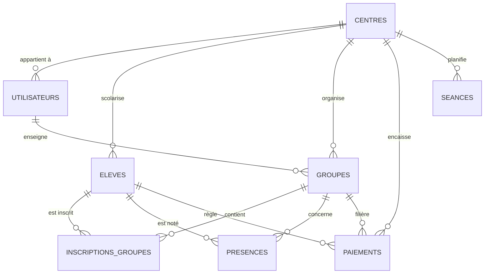

# AUDIT TECHNIQUE COMPLET & REVUE DE PRODUCTION READINESS — AYMNEDU
**Date d'audit :** 11 Novembre 2026  
**Auditeur :** Équipe d'Audit Technique Multidisciplinaire (Senior Software Architect, Lead Security Engineer, Backend/Database Architect, DevOps/Cloud Engineer, Product Lead)  
**Projet audité :** AymnEDU (Gestion d'Écoles et Centres de Soutien Scolaire en Algérie)  
**Version analysée :** 0.1.0 (Codebase locale `aymnedu/`)

---

## 1. RÉSUMÉ EXÉCUTIF (EXECUTIVE SUMMARY)

AymnEDU est une application web full-stack développée en **React 18 + TypeScript + Vite** côté frontend, et **FastAPI + SQLAlchemy + PostgreSQL** côté backend.

### Verdicts Globaux
- **STATUT TECHNIQUE :** **MVP Avancé (Advanced Functional MVP)**
- **MATURITÉ SAAS :** **Application Multi-Tenant Logique (sans moteur d'abonnement / billing)**
- **PRÊT POUR LA COMMERCIALISATION :** **NON (Tests privés / Closed Beta uniquement)**
- **SCORE GLOBAL DE PRODUCTION READINESS :** **52 / 100**

### Synthèse des Forces
1. **Séparation nette et CRUDs fonctionnels :** Les modules Élèves, Groupes, Enseignants, Présences (appel), Emplois du temps (avec détection de conflits horaires/salles) et Paiements (encaissement, acomptes partiels, reçus vectoriels A5 PDF) sont réellement connectés à une base PostgreSQL active. Aucun mock de façade sur les données métiers.
2. **Cloisonnement multi-tenant existant dans les requêtes :** Chaque table métier (`eleves`, `groupes`, `utilisateurs`, `paiements`, `seances`) comporte une clé étrangère `centre_id`. Les services injectent systématiquement `centre_id` issu du token JWT, empêchant l'accès croisé aux ressources d'autres centres.
3. **Optimisations SQL anti N+1 :** Les requêtes utilisent des jointures eagerly-loaded (`joinedload`, sous-requêtes de dénombrement) sur les listes principales.

### Faiblesses et Bloquants Majeurs avant Lancement Commercial
1. **Absence totale de système de facturation et de gestion d'abonnement :** La colonne `Centre.subscription_plan` existe en base mais aucun code ne vérifie les limites de plan, aucune expiration de période d'essai n'est calculée, et aucune passerelle de paiement (Chargily / SATIM / CIB ou validation de virement bancaire CCP/BaridiMob) n'est implémentée. Tout centre inscrit bénéficie d'un accès illimité gratuit.
2. **Fuite d'informations pré-authentification :** L'endpoint public `/api/v1/auth/centres/{id}/roles` expose le nom complet de tous les directeurs, secrétaires et enseignants d'un établissement à n'importe quel internaute non authentifié.
3. **Stockage des JWT en `localStorage` :** Vulnérable au vol de session en cas de faille XSS. Absence de rotation et de révocation en base/Redis des refresh tokens.
4. **Déploiement et migrations fragiles :** Une seule migration Alembic partielle existe (`03dd511366e5`), sans migration initiale de création de tables. Le backend en production sur Render crasherait si la base n'était pas initialisée manuellement au préalable.
5. **Couverture de tests partielle :** 13 tests d'intégration backend (100% passés), mais **0 test unitaire ou E2E côté frontend** et aucun test automatisé sur le flux de paiement partiel ou les conflits d'emploi du temps.
6. **Absence de canal de notification :** Aucun envoi de SMS ou d'e-mail (rappel d'impayé, absence élève, mot de passe oublié).

---

## 2. CLASSIFICATION TECHNIQUE DU PROJET

| Type d'architecture | Définition technique | Statut AymnEDU | Preuve dans le code |
| :--- | :--- | :---: | :--- |
| **Site Web** | Pages statiques ou vitrine de contenu sans persistance transactionnelle complexe. | **Dépassé** | La landing page existe (`LandingPage.tsx`), mais elle n'est que la porte d'entrée vers une SPA dynamique. |
| **Application Web CRUD** | Interface permettant la création, lecture, mise à jour et suppression de données sur une base persistante. | **VALIDÉ** | CRUDs complets opérationnels sur PostgreSQL via FastAPI et React Query. |
| **Application Multi-Tenant** | Une seule instance applicative et base de données servant plusieurs organisations isolées (`tenant_id`). | **VALIDÉ (Niveau Données)** | `centre_id` est obligatoire sur toutes les tables métiers. Isolation vérifiée par les tests (`test_tenant_isolation.py`). |
| **Véritable Plateforme SaaS Commerciale** | Multi-tenant avec gestion du cycle de vie client : souscription, limitations de forfaits, facturation récurrente, portail super-admin, CGU/RGPD, métrologie. | **NON ATTEINT** | Aucune table d'abonnement, pas de webhook de paiement, pas de super-admin, aucun blocage à l'expiration de l'essai. |

> **Classification Réelle :** AymnEDU est une **Application Web Multi-Tenant B2B en phase de MVP Fonctionnel Avancé**, mais **n'est pas encore un SaaS commercialement viable**.

---

## 3. INVENTAIRE DE LA STACK TECHNIQUE

### Backend
- **Framework :** FastAPI 0.111.0
- **Serveur ASGI :** Uvicorn 0.30.0 (déployé en 2 workers)
- **Langage :** Python 3.12 / 3.13
- **ORM :** SQLAlchemy 2.0.30
- **Migrations :** Alembic 1.13.1 (incomplet)
- **Base de données :** PostgreSQL 16 (avec driver `psycopg` / `psycopg2-binary`)
- **Sécurité & Hash :** `bcrypt` direct + `python-jose` (HS256)
- **Validation :** Pydantic V2 + `pydantic-settings`
- **Rate Limiting :** `slowapi` (5 à 10 requêtes / minute sur l'authentification)
- **Observabilité :** `sentry-sdk[fastapi]`

### Frontend
- **Framework :** React 18.3.1
- **Langage :** TypeScript 5.2.2
- **Bundler :** Vite 5.4.21
- **Routage :** React Router DOM 6.24.0 (configuré en `HashRouter`)
- **Server State Management :** TanStack React Query 5.48.0
- **Formulaires & Schémas :** React Hook Form 7.52.0 + Zod 3.23.8
- **Styles :** Tailwind CSS 3.4.4 + Lucide Icons
- **Génération PDF :** jsPDF 2.5.1 (rendu vectoriel A5 en mémoire client)
- **Calendrier :** FullCalendar 6.1.14 (dayGrid, timeGrid, interaction)

### Infrastructure & CI/CD
- **Conteneurs :** Dockerfile backend (Python 3.12-slim), Dockerfile frontend (Node 20 dev)
- **Orchestration locale :** `docker-compose.yml` (Postgres 16, Redis 7, Backend, Frontend)
- **Hébergement prévu :** Render (`render.yaml` pour l'API) + GitHub Pages / Vercel pour le frontend
- **CI/CD :** GitHub Actions (`.github/workflows/deploy.yml` : tests backend sur SQLite + build frontend)

---

## 4. AUDIT DE L'ARCHITECTURE MULTI-TENANT

### Schéma de multi-ténance retenu
AymnEDU utilise le modèle **Shared Database, Shared Schema with Discriminator Column (`centre_id`)**.
Chaque table (`utilisateurs`, `eleves`, `groupes`, `seances`, `paiements`) stocke la clé étrangère `centre_id REFERENCES centres(id) ON DELETE CASCADE`.

### Points de contrôle d'étanchéité

| Ressource | Filtrage Tenant Backend | Risque IDOR constaté | Verdict |
| :--- | :--- | :---: | :---: |
| **Élèves** (`/api/v1/eleves`) | Filtré par `Eleve.centre_id == current_user.centre_id` sur GET, PUT, DELETE. | Aucun | Étanche |
| **Groupes** (`/api/v1/groupes`) | Vérifie `Groupe.centre_id == current_user.centre_id` même sur l'assignation des élèves et des enseignants. | Aucun | Étanche |
| **Paiements** (`/api/v1/paiements`) | Filtré par `Paiement.centre_id == current_user.centre_id` sur lecture, création, encaissement (`/payer`) et versement (`/verser`). | Aucun | Étanche |
| **Présences** (`/api/v1/presences`) | Jointure sur `Groupe.centre_id == centre_id` et vérification des `eleve_ids` du centre. | Aucun | Étanche |
| **Emplois du temps** (`/api/v1/emplois-du-temps`) | Filtré par `Seance.centre_id == centre_id`. Détection de collision restreinte au centre. | Aucun | Étanche |
| **Gestion des accès** (`/api/v1/utilisateurs`) | Seul le directeur peut créer ou modifier des comptes liés à son `centre_id`. | Aucun | Étanche |

### Failles architecturales Multi-Tenant identifiées
1. **Fuite d'utilisateurs inter-centres (Critique Privacy) :**
   - Fichier : `backend/app/api/routes/auth.py` (Ligne 206)
   - Endpoint : `GET /api/v1/auth/centres/{centre_id}/roles`
   - Comportement : Endpoint public non protégé. En passant n'importe quel `centre_id` (1, 2, 3...), l'API renvoie la liste nominative complète des directeurs, secrétaires et enseignants de l'école.
2. **Absence de filtrage automatique au niveau ORM (Row-Level Security ou Session Scope) :**
   - Le filtrage dépend de la rigueur de chaque fonction de service (`filter(Model.centre_id == centre_id)`).
   - Si un développeur oublie ce filtre sur un futur endpoint, la fuite de données est immédiate.
3. **Absence de métadonnées spécifiques au tenant :**
   - Pas de logo d'école en base (le logo sur le reçu PDF est codé en dur "AymnEDU").
   - Pas de paramètres régionaux ou tarifaires propres à chaque école.

---

## 5. AUDIT SÉCURITÉ & AUTHENTIFICATION

### Matrice des vulnérabilités

| Vulnérabilité / Risque | Sévérité | Emplacement | Impact |
| :--- | :---: | :--- | :--- |
| **Fuite de données du personnel non authentifiée** | **ÉLEVÉE** | `backend/app/api/routes/auth.py:206` | Permet le scraping des noms et rôles de toutes les écoles abonnées. |
| **Stockage JWT dans `localStorage`** | **MOYENNE** | `frontend/src/api/client.ts:17` | En cas de vulnérabilité XSS, les tokens d'accès et de refresh peuvent être exfiltrés. |
| **Absence de révocation des Refresh Tokens** | **MOYENNE** | `backend/app/core/security.py:34` | Le refresh token dure 30 jours sans être stocké en base. Un token volé reste valide 30 jours sans possibilité d'invalidation à distance. |
| **Absence de réinitialisation de mot de passe autonome** | **MOYENNE** | `backend/app/api/routes/auth.py` | Si le directeur oublie son mot de passe, aucun flux "Mot de passe oublié" par email n'existe. Intervention manuelle en base obligatoire. |
| **Énumération des comptes via `/auth/register`** | **BASSE** | `backend/app/api/routes/auth.py:99` | Retourne "Un utilisateur avec cet email existe déjà" (HTTP 400), permettant de vérifier si une personne est inscrite. |
| **CORS permissif par défaut en configuration** | **BASSE** | `backend/app/core/config.py:22` | Valeur par défaut `http://localhost:5173`. Doit être strictement vérifié en prod. |

### Vérification du Contrôle d'Accès (RBAC)
Le contrôle d'accès est **réellement appliqué côté backend** via la dépendance `require_role(...)` dans FastAPI :
- Directeur : accès total (inscriptions, suppression d'élèves, gestion des comptes `/utilisateurs`).
- Secrétaire : accès restreint (création/modification élèves, groupes, encaissement, présence). Pas d'accès aux suppressions critiques ni aux rôles.
- Enseignant : accès en lecture seule aux élèves et groupes, saisie d'appels (`/presences`) et consultation du planning.

---

## 6. AUDIT BASE DE DONNÉES & COUCHE BACKEND

### Modélisation des données (PostgreSQL)



### Évaluation du Schéma Relationnel
- **Contraintes d'unicité métier :**
  - `uq_inscription_eleve_groupe` : empêche la double inscription d'un élève dans un même groupe.
  - `uq_paiement_eleve_groupe_mois` : empêche la double facturation d'un élève pour le même groupe sur le même mois.
  - `uq_presence_eleve_groupe_date` : empêche les doublons d'émargement d'un élève à la même date.
- **Intégrité référentielle :** Clés étrangères protégées par `ON DELETE CASCADE` vers `centres` et `eleves`.
- **Soft Deletes :** Implémenté sur `eleves` (`deleted_at`) et `groupes` (`deleted_at`).
- **Anomalie de migration :** La table `alembic_version` ne reflète pas la création initiale des tables. Une base vierge exécutant `alembic upgrade head` échouera sans initialisation préalable par `create_all()`.

---

## 7. AUDIT FONCTIONNEL MODULE PAR MODULE

| Module Métier | Implémentation Backend | Implémentation Frontend | Statut Réel | Commentaires & Écarts |
| :--- | :---: | :---: | :---: | :--- |
| **A. Élèves** | Complète | Complète | **100% Fonctionnel** | Pagination serveur, recherche, création, édition, soft-delete. |
| **B. Enseignants** | Complète | Complète | **95% Fonctionnel** | Création de compte enseignant, suppression, liaison avec les groupes. Manque la gestion de volume horaire / salaire. |
| **C. Groupes** | Complète | Complète | **100% Fonctionnel** | Capacité max vérifiée, assignation prof, inscription/désinscription d'élèves en modal avec recherche dynamique. |
| **D. Présences** | Complète | Complète | **100% Fonctionnel** | Appel numérique rapide par groupe et date. Statuts présent/absent/retard. Enregistrement par lot optimisé. |
| **E. Emploi du temps** | Complète | Complète | **100% Fonctionnel** | Calendrier hebdomadaire FullCalendar. Détection serveur des conflits de salle et de professeur (HTTP 409). |
| **F. Paiements & Caisse** | Complète | Complète | **100% Fonctionnel** | Gestion des montants totaux, acomptes partiels (`montant_verse`), solde restant, émission de reçu PDF A5 et impression directe. |
| **G. Tableau de bord** | Complète | Complète | **90% Fonctionnel** | Calcul SQL dynamique (aucun mock) : effectifs, encaissé, impayés, taux d'assiduité 7 jours. Manque l'évolution mensuelle graphique. |
| **H. Notifications** | Absente | Absente | **MANQUANT** | Aucun service d'envoi de SMS (recommandé pour l'Algérie) ni d'e-mails de relance. |
| **I. Facturation SaaS** | Absente | UI Seule | **MANQUANT** | Page de tarifs présente sur la vitrine, mais aucun moteur d'abonnement ou de facturation du centre vers AymnEDU. |

---

## 8. AUDIT DU BUSINESS MODEL SAAS & ABONNEMENTS

### Constat
La vitrine commerciale annonce deux forfaits :
1. **Starter :** 0 DA / 14 jours (Essai gratuit sans carte).
2. **Soutien Pro :** 4 500 DA / mois.

### Analyse Technique de la Souscription
Dans `backend/app/api/routes/auth.py` (Ligne 112) :
```python
centre = Centre(
    nom=body.nom_centre,
    wilaya=body.wilaya,
    telephone=body.telephone,
    subscription_plan="starter",
    is_active=True
)
```
- Aucun champ `trial_ends_at` ou `subscription_expires_at` n'existe dans la table `centres`.
- Aucun middleware ne bloque l'accès aux fonctionnalités après 14 jours.
- Aucune passerelle de paiement n'est intégrée.
- Aucun back-office "Super Admin" n'existe pour que le créateur d'AymnEDU puisse voir la liste des centres inscrits, valider un paiement reçu par virement CCP/BaridiMob, ou couper l'accès d'un centre mauvais payeur.

### Recommandation pour le marché algérien
En Algérie, les directeurs d'écoles privées règlent majoritairement par :
1. **Virement BaridiMob / CCP** avec envoi du reçu de virement.
2. **Paiement en espèces** avec quittance manuelle.
3. **Carte CIB / Edahabia** via la passerelle algérienne **Chargily Pay**.

---

## 9. AUDIT QUALITÉ, TESTS & PERFORMANCE

### Résultats des Tests Existants
- **Suite de tests :** Pytest (Backend)
- **Fichiers :** `test_auth.py`, `test_paiements.py`, `test_tenant_isolation.py`
- **Résultat d'exécution :** **13 tests exécutés, 13 passés (100% succès)** en 5.91 secondes.
- **Points forts :** Les tests de cloisonnement inter-tenant vérifient rigoureusement que le Centre A ne peut ni voir ni modifier les élèves, groupes ou paiements du Centre B.
- **Lacunes majeures :**
  - Aucun test sur les conflits de planning (`seances`).
  - Aucun test sur les versements partiels (`/verser`).
  - Aucun test unitaire ou E2E sur le frontend React (0% de couverture frontend).

### Performance et Scalabilité
1. **10 à 50 centres :** L'architecture actuelle (FastAPI + PostgreSQL + index de base) traitera la charge sans aucun ralentissement sur un VPS standard (2 vCPU, 4 Go RAM).
2. **100 à 500 centres :**
   - La requête `/auth/centres/search` sans cache deviendra lente si la table `centres` grossit sans index trigramme (`pg_trgm`).
   - L'agrégation du Dashboard sur `paiements` et `presences` nécessitera des index composites sur `(centre_id, mois)` et `(centre_id, date_seance)`.
   - Nécessité d'activer le pooling de connexions PostgreSQL (PgBouncer).

---

## 10. SCORECARD DE PRODUCTION READINESS

| Catégorie | Note / 100 | Pondération | Score Pondéré | Commentaire |
| :--- | :---: | :---: | :---: | :--- |
| **1. Architecture SaaS Multi-Tenant** | 70 | 12% | 8.4 | Isolation logique robuste par `centre_id`. Manque le super-admin. |
| **2. Sécurité & Authentification** | 62 | 12% | 7.44 | RBAC serveur réel, mais tokens en localStorage et fuite des noms de rôles. |
| **3. Backend & API** | 80 | 12% | 9.6 | Code propre, typé Pydantic V2, validation stricte, pas de code mort critique. |
| **4. Base de données & Modélisation** | 72 | 10% | 7.2 | Schéma normalisé, contraintes d'unicité solides. Migrations Alembic à refaire. |
| **5. Fonctionnalités Métier** | 82 | 12% | 9.84 | Élèves, Groupes, Enseignants, Présences, Planning et Reçus opérationnels. |
| **6. Facturation & Souscription SaaS** | 05 | 10% | 0.5 | Quasi inexistant (pas de paiement, pas de gestion de licences). |
| **7. Frontend & UX/UI** | 80 | 10% | 8.0 | Interface soignée, Tailwind sombre, responsive, export PDF propre. |
| **8. Tests & Assurance Qualité** | 40 | 8% | 3.2 | 13 tests backend solides, mais 0 test frontend et couverture globale < 35%. |
| **9. DevOps & Déploiement** | 45 | 8% | 3.6 | Dockerfile dev en frontend, CI GitHub Pages inadaptée au backend. |
| **10. Documentation & Cadre Légal** | 30 | 6% | 1.8 | Pas de CGU/Politique de confidentialité adaptée à la loi 18-07 algérienne. |
| **TOTAL GÉNÉRAL** | — | **100%** | **59.58 / 100** | **Note Globale : ~60 / 100 (Mention : Bon prototype / Beta fermée)** |

---

## 11. PLAN D'ACTION PRIORISÉ (REMEDIATION ROADMAP)

### PHASE 1 — BLOQUANTS CRITIQUES (Semaine 1)
1. **Corriger la fuite d'informations `/auth/centres/{id}/roles` :**
   - Remplacer le formulaire de connexion public basé sur la liste du personnel par une connexion standard (Email + Mot de passe) ou protéger cet endpoint.
   - *Fichiers :* `backend/app/api/routes/auth.py`, `frontend/src/pages/LoginPage.tsx`.
2. **Générer une migration initiale Alembic propre :**
   - Créer une révision Alembic 001 contenant le schéma complet `Base.metadata` pour permettre le déploiement sur une base vierge en production.
   - *Fichiers :* `backend/migrations/`.
3. **Sécuriser la configuration de production :**
   - Forcer `SECRET_KEY` non vide au démarrage via Pydantic validator.
   - Restreindre les origines CORS au nom de domaine officiel.

### PHASE 2 — MODULE SAAS & FACTURATION (Semaines 2 à 3)
1. **Gestion du cycle de vie du Centre :**
   - Ajouter `trial_ends_at`, `subscription_status` (`trial`, `active`, `past_due`, `canceled`) sur `centres`.
   - Créer un middleware de vérification d'abonnement : si le compte a expiré, redirection vers une page "Abonnement expiré".
2. **Passerelle de paiement locale ou manuelle :**
   - Intégrer l'API **Chargily Pay V2** (CIB / Edahabia) pour le paiement en ligne en Dinars Algériens.
   - Ajouter un formulaire d'envoi de reçu BaridiMob pour validation manuelle par l'administrateur.
3. **Dashboard Super-Administrateur de la plateforme :**
   - Espace réservé à l'équipe AymnEDU pour suivre les écoles clientes, activer/suspendre les comptes et voir le MRR.

### PHASE 3 — HARDENING & DEVOPS (Semaine 4)
1. **Dockerfile Frontend de production :**
   - Remplacer `npm run dev` par un build multi-stage `node:alpine` -> `nginx:alpine`.
2. **Notifications par SMS :**
   - Connecter un fournisseur SMS local pour notifier les parents lors des absences ou rappels d'échéances de cours.
3. **Tests d'intégration supplémentaires :**
   - Couvrir les cas limites des emplois du temps et des paiements partiels.

---

## 12. DÉCISION FINALE & VERDICT

- **PUIS-JE LE DÉPLOYER AUJOURD'HUI ?**
  **OUI**, pour une phase de démonstration ou de **Beta fermée gratuite** avec 2 ou 3 écoles partenaires de confiance.
- **PUIS-JE FACTURER DES CLIENTS AUJOURD'HUI ?**
  **NON**, car le produit n'a aucun moyen d'encaisser les abonnements ni de couper l'accès aux centres non payeurs de manière automatisée.
- **VERDICT D'ÉQUIPE :** **FEU ORANGE (GO EN BETA PRIVÉE / NO-GO EN COMMERCIALISATION OFFICIELLE)**.
Le cœur technique métier (gestion quotidienne d'un centre) est remarquablement bien codé et fonctionnel. Il ne manque que la couche "SaaS Business" (Abonnements, Super-Admin, Sécurité tokens, Déploiement Nginx) pour transformer cette excellente application en entreprise commerciale pérenne.

